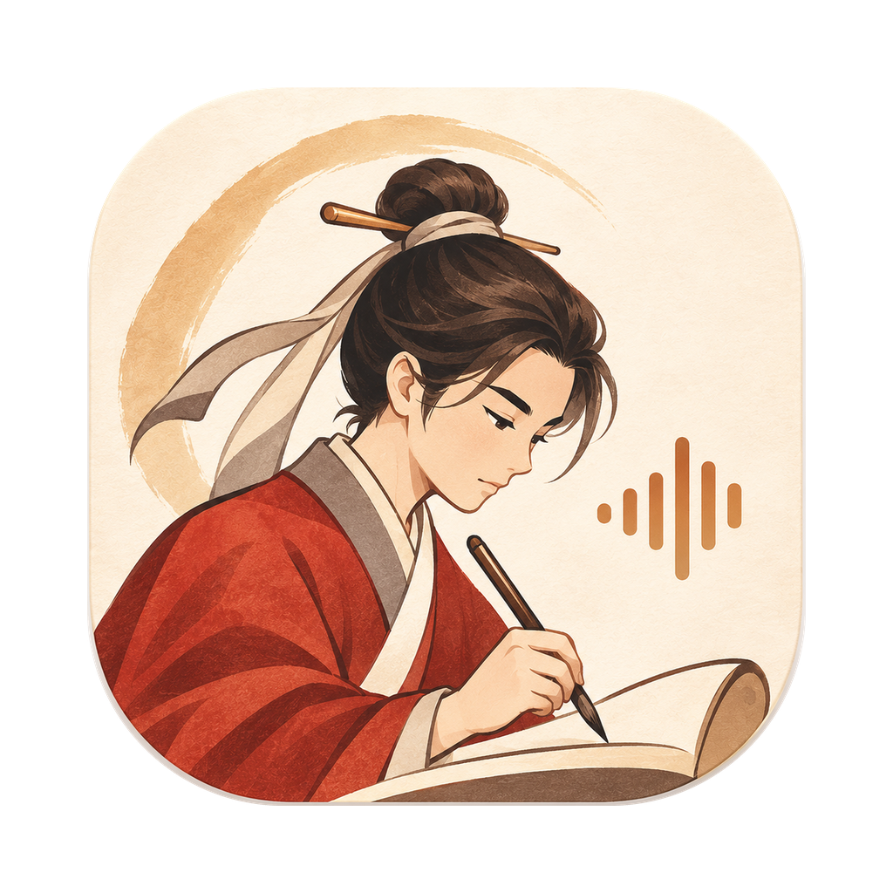

<div align="center">



# 笔受 · Penshow

**闻其言，成其文。**

按住一个键说话，松开即把文字送进当前应用。<br />
语音识别在本机完成，可选接入自己的 AI 服务润色。

<br />

[](https://github.com/LiuXiYing/penshow/releases)


<br />

[**下载 DMG**](https://github.com/LiuXiYing/penshow/releases/latest) · [功能](#功能) · [模型](#本地模型) · [AI-润色](#ai-润色) · [从源码构建](#从源码构建)

</div>

---

## 功能

<table>
  <tr>
    <td width="50%" valign="top">
      <h3>🎙 按住即说</h3>
      按住 <kbd>Fn</kbd> 或自定义快捷键，在任意输入框听写；双击可保持录音，再按结束。
    </td>
    <td width="50%" valign="top">
      <h3>🔒 本机识别</h3>
      Qwen3-ASR、Nemotron 等支持中文的模型在本地运行，Metal 加速，断网也能用。
    </td>
  </tr>
  <tr>
    <td valign="top">
      <h3>✍️ 中文优先的润色</h3>
      内置中文提示词：去口癖、改错别字、补全角标点、识别自我纠正、口述数字与标点。
    </td>
    <td valign="top">
      <h3>🇨🇳 国内可用的 AI</h3>
      DeepSeek、Kimi、智谱、百炼、硅基流动、火山方舟开箱即选，也可填任意 OpenAI 兼容端点。
    </td>
  </tr>
  <tr>
    <td valign="top">
      <h3>💬 按应用切换语气</h3>
      在 Slack 里口语化、在邮件里正式、在编辑器里保留标识符与大小写。
    </td>
    <td valign="top">
      <h3>📚 词汇与历史</h3>
      自定义词汇和语音片段一次配置、随说随用；历史记录可回看、复制、重新处理。
    </td>
  </tr>
</table>

## 安装

1. 从 [Releases](https://github.com/LiuXiYing/penshow/releases/latest) 下载 `Penshow-*-aarch64.dmg`。
2. 打开 DMG，把 **Penshow** 拖进「应用程序」。
3. 首次启动按提示授予「麦克风」与「辅助功能」权限。

> **被 Gatekeeper 拦下？** 右键点击 App → **打开**，或到「系统设置 → 隐私与安全性」点 **仍要打开**。
> 本地构建为 ad-hoc 签名，覆盖安装后若听写无反应，执行
> `tccutil reset Accessibility com.hush.software` 再重新授权即可。

## 本地模型

所有可选模型都支持中文；不支持中文的模型不会出现在列表里。

| 模型                      | 特点               | 体积（默认量化） |
| ------------------------- | ------------------ | ---------------- |
| **Qwen3-ASR 1.7B** · 首选 | 中文与中英混排最准 | 约 2.2 GB        |
| Qwen3-ASR 0.6B            | 更快、更省内存     | 约 850 MB        |
| Nemotron Streaming 0.6B   | 边说边出字         | 约 700 MB        |

模型从 Hugging Face 下载，内置 SHA-256 校验；已下载的模型会直接复用。

## AI 润色

语音识别之后，可选把文本交给大模型整理。内置以下中国大陆可直接访问的服务：

| 服务                 | 默认接口                                    |
| -------------------- | ------------------------------------------- |
| DeepSeek 深度求索    | `api.deepseek.com/v1`                       |
| Kimi 月之暗面        | `api.moonshot.cn/v1`                        |
| 智谱 GLM             | `open.bigmodel.cn/api/paas/v4`              |
| 阿里云百炼           | `dashscope.aliyuncs.com/compatible-mode/v1` |
| 硅基流动 SiliconFlow | `api.siliconflow.cn/v1`                     |
| 火山方舟             | `ark.cn-beijing.volces.com/api/v3`          |
| 自定义               | 任意 OpenAI 兼容地址                        |

模型名可以**直接输入**，也可以点刷新按钮**从厂商 `/models` 接口获取**。
默认提示词是一套中文整理规则，可随时在设置里修改；按应用的语气规则会在其后追加。

## 从源码构建

需要 macOS、Xcode Command Line Tools、Rust、Bun 和 CMake。

```bash
git clone https://github.com/LiuXiYing/penshow.git
cd penshow
bun install
CMAKE_POLICY_VERSION_MINIMUM=3.5 bun run tauri dev
```

打包 Apple Silicon DMG：

```bash
CMAKE_POLICY_VERSION_MINIMUM=3.5 bun run tauri build --target aarch64-apple-darwin --bundles dmg
```

产物在 `src-tauri/target/aarch64-apple-darwin/release/bundle/dmg/`。更多细节见 [BUILD.md](BUILD.md)。

<details>
<summary><strong>与上游同步 / 目录结构</strong></summary>

<br />

Penshow 基于 Hush 1.1.0 继续开发，可随时合并上游改动：

```bash
git remote add upstream https://github.com/DeepanshuPal/hush.git
git fetch upstream
git merge upstream/main
```

| 目录         | 内容                                           |
| ------------ | ---------------------------------------------- |
| `src/`       | 界面（React、TypeScript、Tailwind）            |
| `src-tauri/` | 核心（Rust、Tauri）：音频、识别、润色、粘贴    |
| `assets/`    | 图标与 README 图片                             |
| `website/`   | 上游网站源码（Next.js），尚未针对 Penshow 修改 |
| `docs/`      | 文档与图片                                     |

上游原始 README 保留在 [README.upstream.md](README.upstream.md)。

</details>

## 来源与署名

> Penshow（笔受）基于开源项目 **Hush** 开发，特此明确署名。

|          |                                              |
| -------- | -------------------------------------------- |
| 原始项目 | [Hush](https://github.com/DeepanshuPal/hush) |
| 作者     | Deepanshu Pal                                |
| 许可证   | MIT                                          |
| 原始版权 | Copyright (c) 2026 Deepanshu Pal             |

Penshow 完整保留原始项目的 MIT 许可证、版权声明与第三方组件许可。Penshow 与 Hush 原作者没有隶属关系，也未获得其背书；Hush 的名称、图标与原始文案归原作者所有。详见 [ATTRIBUTION.md](ATTRIBUTION.md)、[LICENSE](LICENSE) 与 [THIRD_PARTY_NOTICES.md](THIRD_PARTY_NOTICES.md)。

## 许可证

Penshow 以 [MIT License](LICENSE) 发布。原始项目 Hush © 2026 Deepanshu Pal；Penshow 的修改 © 2026 Penshow contributors。第三方字体与语音模型等组件的许可见 [THIRD_PARTY_NOTICES.md](THIRD_PARTY_NOTICES.md)。

<div align="center">
<br />
<sub>Penshow is a macOS push-to-talk dictation app built on Hush. Speech recognition runs locally; AI clean-up is optional.</sub>
</div>
